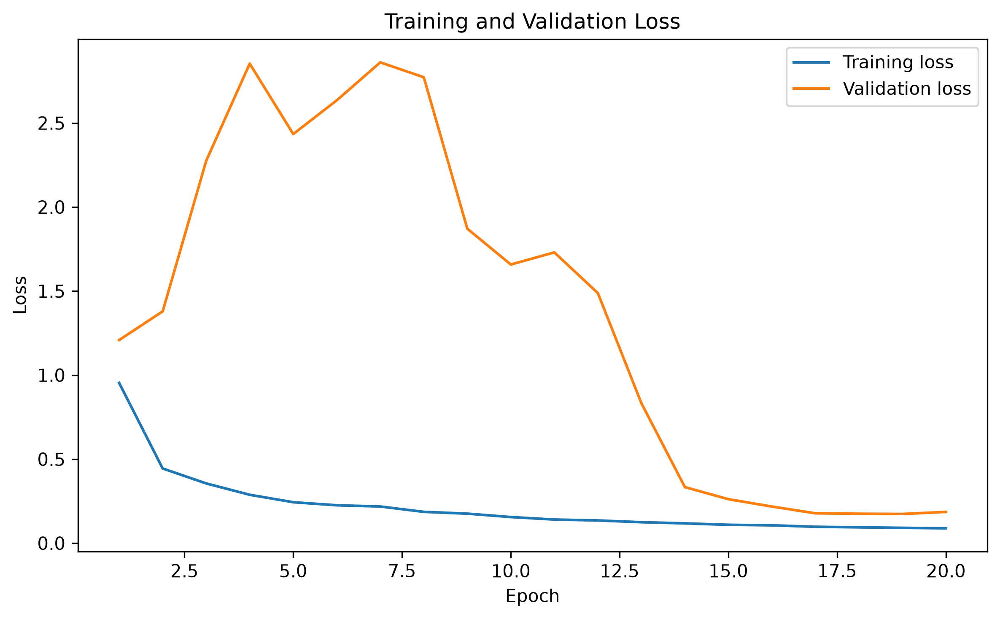
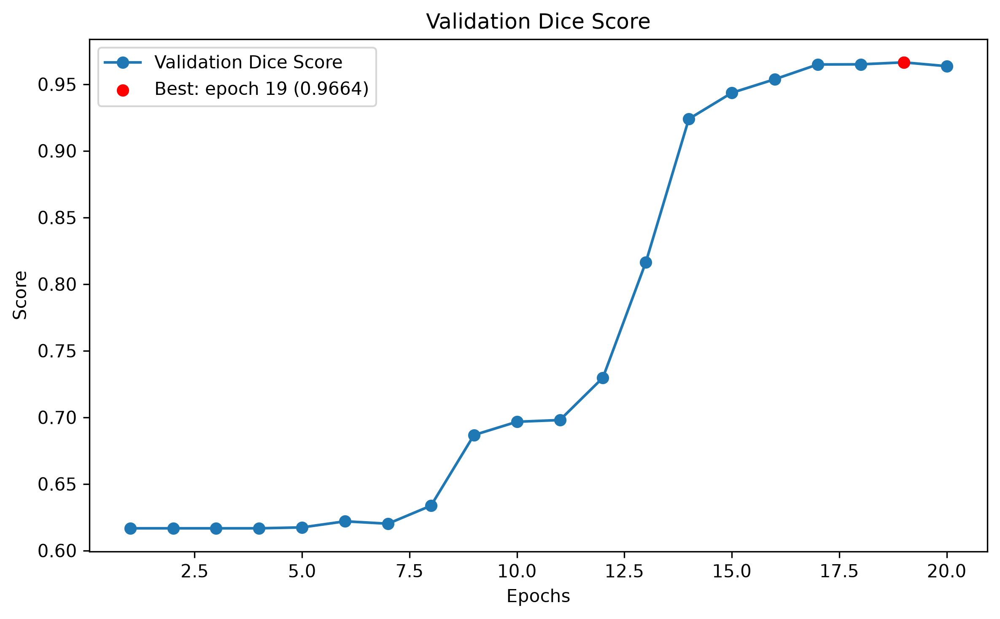
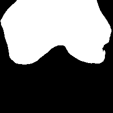

# Knee X-ray U-Net Segmentation

Binary segmentation of the femur in knee X-ray images using U-Net.

## Dataset

The dataset contains 64 training images, 16 validation images, and 50 unlabeled test images.

The image data is not included in this repository. CSV files are expected in `data/CSVs/`. Training and validation CSVs contain `xrays` and `masks` columns, while the test CSV contains `xrays`.

## Method

The model uses a modified U-Net with single-channel input and output. It was trained for 20 epochs using:

- BCE with logits combined with soft Dice loss
- Adam optimizer with a learning rate of `0.001`
- Batch size of `16`
- Horizontal-flip augmentation
- Checkpoint selection by highest validation Dice score

## Results

The best model was selected at epoch 19 and achieved a validation Dice score of **0.9664**. The test set has no reference masks, so its predictions were evaluated visually.

| Experiment | Validation Dice |
|---|---:|
| No augmentation | 0.9634 |
| Rotation augmentation | 0.9639 |
| Horizontal-flip augmentation | **0.9664** |

### Training and validation loss



### Validation Dice



### Example predicted mask



## Usage

Install the dependencies:

```bash
pip install -r requirements.txt
```

Train the model:

```bash
python main.py -out_dir sessions/run
```

Evaluate the saved checkpoint and generate test predictions:

```bash
python evaluate.py -out_dir sessions/run
```

## Model Attribution

The U-Net implementation in `model.py` is adapted from [Aleksei Tiulpin’s deep-pipeline project](https://github.com/lext/deep-pipeline/blob/master/deeppipeline/segmentation/models/_unet.py) and is used under the MIT License included in this repository.
